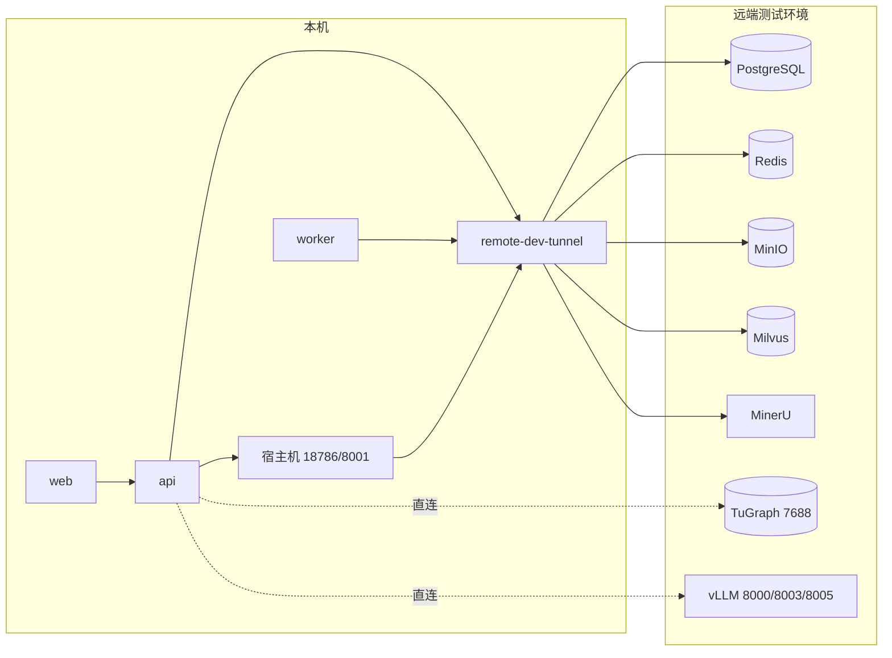

# 本地开发连接远端中间件

本页适用于代码跑在本机、而 PostgreSQL、Redis、MinIO、Milvus、MinerU 等中间件留在远端测试环境的开发方式。目标是本机能完整运行 API、worker 与前端，同时不改变远端正在运行的版本。

## 为什么需要隧道

远端 compose 把 PostgreSQL、Redis、MinIO、Milvus 的宿主端口绑定在 `127.0.0.1`，局域网无法直接连接；MinerU 只监听 docker0 网桥地址。只有 TuGraph（`7688`）与远端 vLLM 服务监听 `0.0.0.0`，可以直连。

因此在 Compose 网络里运行一个 SSH 隧道容器 `remote-dev-tunnel`，把远端端口转发成网络内的服务名，应用按服务名连接。隧道容器同时在宿主机发布 `18786` 与 `8001` 两个端口：共享数据库里的系统配置把 MinerU 写成 `host.docker.internal:18786`、把语音识别写成 `localhost:8001`（运行进程会把后者改写成 `host.docker.internal`），这两种写法只能通过宿主机端口满足。



## 隔离边界

本机实例与测试环境共享存储、但队列与运行进程分开。

| 资源 | 本机开发 | 测试环境 |
| --- | --- | --- |
| Redis | 独立库 `/9` | 主栈 `/0`、隔离栈 `/1` |
| PostgreSQL | 同一个库 | 同一个库 |
| MinIO、Milvus、TuGraph | 同一个实例 | 同一个实例 |
| API、worker、sandbox-provisioner | 本机容器 | 远端容器 |
| Schema 迁移 | 只校验版本 | 自己的一轮迁移 |

三个约束决定了这套配置能成立：

- Redis 必须换库。两个 worker 连同一个库时会抢同一个 ARQ 队列，本机的代码改动可能被远端 worker 执行，双方还会互相覆盖 worker 健康键。远端主栈占 `/0`、隔离栈占 `/1`，本机用 `/9`；换库前先确认目标库没有别的实例在用。
- 运行进程不迁移 Schema。API 与 worker 启动时只调用 `require_current_schema`；迁移由 `storage-migrator` 单独执行，远端版本与本机代码不一致时直接失败，不会改动远端库。
- 知识库数据共享意味着本机调试产生的会话、消息与运行记录会写进测试环境的数据。需要数据也隔离时，另建库并把下面的 `POSTGRES_URL` 指向新库。

## 前置条件

- Docker Engine 28.0 或更高版本、Docker Compose v2.33.1 或更高版本。`docker-compose.yml` 的 `sandbox-provisioner` 使用 `gw_priority`，低版本 Compose 会在校验阶段直接拒绝整份文件。
- 能通过 SSH 登录远端主机，并在远端 `~/.ssh/authorized_keys` 安装本机公钥。
- 本机能访问 Docker Hub 或可用的镜像加速站，构建镜像时需要基础镜像。

## 准备步骤

### 1. 配置 SSH 免密

在项目内生成专用密钥，并把公钥装到远端。密钥目录被 `.gitignore` 忽略，不会进入版本库。

```powershell
New-Item -ItemType Directory -Force docker/volumes/remote-dev/ssh | Out-Null
ssh-keygen -t ed25519 -N '""' -C "yuxi-remote-dev" -f docker/volumes/remote-dev/ssh/id_ed25519
Get-Content docker/volumes/remote-dev/ssh/id_ed25519.pub
```

把公钥内容追加到远端的 `~/.ssh/authorized_keys`，再把远端的 SSH 主机公钥写入 `docker/volumes/remote-dev/ssh/known_hosts`。隧道容器用 `StrictHostKeyChecking=yes` 校验该文件，主机密钥变化时会拒绝连接。

### 2. 配置 .env

`.env` 被 `.gitignore` 忽略，远端地址与凭据只保存在这里。至少需要以下变量。

| 变量 | 作用 |
| --- | --- |
| `YUXI_REMOTE_HOST` | 远端主机地址，隧道容器据此建立连接 |
| `YUXI_REMOTE_SSH_USER` | SSH 用户，默认 `root` |
| `YUXI_REMOTE_SSH_DIR` | 私钥与 `known_hosts` 所在目录，默认 `./docker/volumes/remote-dev/ssh` |
| `POSTGRES_URL` | 指向 `remote-dev-tunnel:5432` 的异步连接串 |
| `REDIS_URL` | 指向 `remote-dev-tunnel:6379/9`，库号必须独占 |
| `MILVUS_URI` | `http://remote-dev-tunnel:19530` |
| `MINIO_URI` | `http://remote-dev-tunnel:9000` |
| `MINIO_ACCESS_KEY`、`MINIO_SECRET_KEY` | 远端 MinIO 凭据 |
| `MINERU_API_URI` | `http://remote-dev-tunnel:18786` |
| `GRAPH_BACKEND`、`TUGRAPH_URI` | `tugraph` 与 `bolt://<远端主机>:7688` |
| `SPEECH_ASR_BASE_URL` | `http://<远端主机>:8001` |
| `YUXI_AGENT_MAX_CONCURRENT_RUNS` | 同一 Agent 的在途 Run 上限；与测试环境共用推理服务，额度按共享数据库全局计算 |

模型供应商不需要在本机配置：供应商记录保存在共享数据库里，地址本身就是远端局域网地址，本机容器可以直接访问。

### 3. 启动

```powershell
./scripts/dev-remote.ps1 up
```

脚本按顺序做四件事：启动并等待隧道健康、运行 `storage-migrator`、启动 `api`/`worker`/`web`/`sandbox-provisioner`、轮询 `/api/system/ready` 直到就绪。

本机不启动 `postgres`、`redis`、`minio`、`milvus`、`etcd`、`graph`、`tugraph` 这些服务，所以脚本里所有 `docker compose` 调用都带 `--no-deps` 并显式列出服务名。直接执行 `docker compose up -d` 会连带启动本机中间件容器。

常用命令：

```powershell
./scripts/dev-remote.ps1 status   # 容器状态
./scripts/dev-remote.ps1 logs     # 隧道与 api/worker 日志
./scripts/dev-remote.ps1 down     # 停止本机栈
```

## 验证

`/api/system/ready` 返回 `"status": "ready"` 表示 PostgreSQL、Redis、worker 健康租约与全部必需启动组件都已就绪；其中 `knowledge_base` 组件连接 Milvus，`sandbox_provider` 组件连接本机 provisioner。

```powershell
Invoke-RestMethod http://127.0.0.1:5050/api/system/ready | ConvertTo-Json -Depth 5
```

单独核对某个后端时，从隧道容器内部发起连接最直接，因为它同时覆盖 SSH 通道与远端服务：

```powershell
docker compose -f docker-compose.yml -f docker-compose.remote-dev.yml exec -T remote-dev-tunnel `
  sh -c "printf 'PING\r\n' | nc -w 5 127.0.0.1 6379"
```

## 排障

| 现象 | 原因与处理 |
| --- | --- |
| `Additional property gw_priority is not allowed` | Compose 版本过低，升级 Docker Desktop 或 Compose |
| 隧道容器反复重启 | `docker compose logs remote-dev-tunnel` 查看 SSH 报错；常见原因是私钥未安装、`known_hosts` 不匹配或远端不可达 |
| `storage-migrator` 报 Schema 版本不匹配 | 本机分支的 Schema 版本与远端库不一致；不要改远端库，改用独立数据库验证迁移 |
| 知识库解析报 MinerU 连接失败 | 宿主机 `18786` 未发布或被占用，检查隧道容器的端口映射 |
| worker 一直显示 `health: starting` | 本机冷启动 `uv` 并导入 `yuxi` 约需 20 秒，超过镜像默认 10 秒健康检查超时；`docker-compose.remote-dev.yml` 已放宽该超时，若仍失败看 worker 日志 |
| 隧道重建后 `/api/system/ready` 报 `worker: error` | 隧道重建会断开既有 Redis 连接，worker 子进程随之退出；`watchfiles` 不会重启已退出的子进程，容器仍显示 `Up`。执行 `./scripts/dev-remote.ps1 restart` 恢复 |
| 认证失败或登录态串环境 | 两个环境的 `JWT_SECRET_KEY` 不同；需要复用登录态时保持两者一致 |

## 影响与限制

- 所有中间件流量经过一条 SSH 连接多路复用，吞吐低于本机部署；大数据量索引构建会明显变慢。
- 本机 `storage-migrator` 会执行 `ensure_options_in_db`，把代码里的系统配置定义同步进共享库。它保留管理员已保存的值，只覆盖名称、说明与参数定义；本机代码改了配置定义时会影响测试环境的展示。
- 沙箱运行在本机 Docker 上，沙箱容器的用户数据来自本机状态目录，与远端沙箱互不影响。
