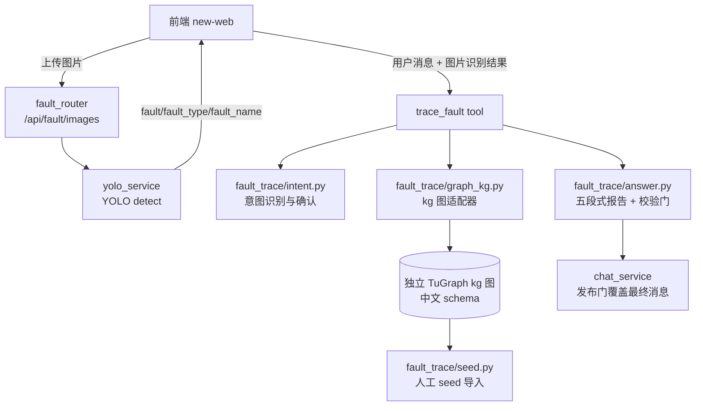

# 故障溯源

本页解释设备故障图片怎样被识别、故障图谱数据怎样进入知识图谱，以及一次故障描述怎样变成五段式溯源报告。它面向需要阅读、评审或修改该链路的开发者，重点是每层的 Owner、数据形态和可逐步执行的调试入口。

## 适用范围

故障溯源由三条相互独立的链路组成，修改其中一条不会自动修复另外两条。

- **图片识别链路**：`POST /api/fault/images` 受理前端上传的故障图片，转发 YOLO 服务（`fault_image_opts.server_url`，由管理员配置）识别，返回 `fault`/`fault_type`/`fault_name`；另 `GET /api/fault/health` 透传 YOLO 健康状态。
- **图谱数据链路**：人工维护的 seed JSON 经 `fault_trace/seed.py` 幂等写入**独立 TuGraph `kg` 图**（中文 schema，节点按主键 MERGE、边按两端主键 MERGE），数据来源是人工录入的知识图谱数据库。
- **溯源链路**：`trace_fault` 工具把用户描述与图片结果融合意图识别，经 `fault_trace/graph_kg.py` 直连 `kg` 图取因果链与电气拓扑，生成五段式报告；`chat_service` 发布门用工具产出的报告覆盖最终消息。

## 组件与依赖



依赖方向只有一条：`tool` 只做权限、意图确认与行为链编排，意图、图谱查询、报告装配各自拥有模块，跨模块流动的数据形状统一由 `fault_trace/contracts.py` 拥有。

## 图片识别链路

`server/routers/fault_router.py` 的 `POST /api/fault/images` 只接受 `image/*`，读取上限 `MAX_FAULT_IMAGE_BYTES`（10MB）。`yuxi/services/yolo_service.py` 负责转发：识别到故障时返回 `fault_type`/`fault_name`，未识别到返回空类别；服务不可达/非 200/响应不合法一律抛 `YoloServiceError`，路由投影为 502，**不把失败伪装成“未识别到故障”**。识别结果由前端拼入下一条用户消息（或作为 `trace_fault` 的 `image_result` 参数），图片同时走既有 attachments 流留痕。

## 图谱数据链路

故障模式、原因、处置措施与电气拓扑由人工录入到独立 TuGraph `kg` 图（连接由管理员配置 `fault_trace_opts`：`server_url`/`graph`/`username`/`password`，如 `bolt://<tugraph-host>:7688`、`kg`），或由 `fault_trace/seed.py` 从 seed JSON 批量导入（结构见模块 docstring）。导入命令：

```bash
python -m yuxi.knowledge.fault_trace.seed --uri bolt://<tugraph-host>:7688 --graph kg \
    --username <user> --password '<password>' --file <seed.json>
```

kg 图中文 schema（写入与读取的约定契约）：

| 中文节点标签 | 内部实体类型 | 主键 |
|---|---|---|
| `设备实例` | `device` | `id`（台账已有节点；seed 新建设备用 `设备实例#<hash>`） |
| `故障模式` | `fault_mode` | `名称` |
| `故障现象` | `phenomenon` | `名称` |
| `故障原因` | `cause` | `名称` |
| `处置措施` | `measure` | `名称` |
| `诱发因素` | `trigger` | `名称` |

| 中文关系 | 内部关系类型 | 方向 |
|---|---|---|
| `存在故障模式` | `has_fault_mode` | 设备→模式 |
| `表现为` | `has_phenomenon` | 模式→现象 |
| `起因` | `has_cause` | 模式→原因 |
| `处理` | `has_measure` | 原因→措施 |
| `诱发条件` | `has_trigger_condition` | 模式→诱因 |
| `电连接` | `electrically_connected_to` | 设备→设备（方向=功率流向） |

导入前 `_ensure_kg_schema` 幂等注册所需点/边标签（TuGraph 中文标签必须先注册且 pattern 中不能加反引号）；已存在的台账设备按名称查找并复用其 `id`，不新建重复设备。重复导入幂等（节点/边均 MERGE）；语义正确性由人工维护与真实图谱回读校验，导入不做语义推断。

## 溯源链路

`trace_fault` 工具输入：`query_text`、`image_result`（可选）、`confirmed_intent`。

1. 意图识别（`fault_trace/intent.py`）：规则解析兜底，模型识别为增强（关闭思考、temperature 0）；融合图片识别结果。按 SRS 输入约束设置澄清：设备名必须具体（仅“变压器”这类类型词视为不明确）、图像不可单独诊断；不完整输入返回 `clarification` 话术（方案二/三）。用户确认走 `fault_trace_intent_confirm` 卡片（复用 power_spec 的 interrupt 模式）。
2. 图谱查询（`fault_trace/graph_kg.py`）：直连 `kg` 图（`KgGraphClient`），先按设备名匹配 `设备实例`，再沿 `存在故障模式`/`表现为`/`起因`/`处理`/`诱发条件` 取因果链、沿 `电连接` 取上下游拓扑；现象关键词反向匹配故障模式（SRS：以现象为起点沿 has_phenomenon 反查）。TuGraph 只读限制（单 MATCH、中文标签、`LIMIT $node_limit` 参数名）在适配器内消化；结果映射为内部英文类型的 `FaultGraphEvidence`，装配逻辑不感知双语差异。
3. 报告装配（`fault_trace/answer.py`）：结构由图谱证据确定性生成（五段式）；`summary`/`evidence_note` 允许模型润色但必须通过允许词门与数字门，否则回退确定性文案。`chat_service` 的 `_resolve_fault_trace_output` 发布门只认本轮 `trace_fault` 的工具结果，用 `answer_markdown` 覆盖最终消息。

调试入口：真实图谱回读（`CALL db.vertexLabels()`、`MATCH (n) WHERE labels(n)[0]='故障模式' RETURN n`）验证数据；`answer.py` 日志中的“报告润色未通过允许词/数字门”表示模型文案不满足证据约束、使用了回退文案；`tool.py` 日志“故障溯源图谱查询失败”表示 kg 连接/查询失败（用户会看到“图谱暂时不可用”文案，与“未配置”区分）。