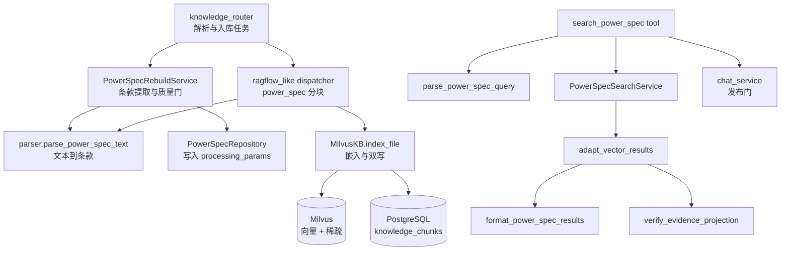
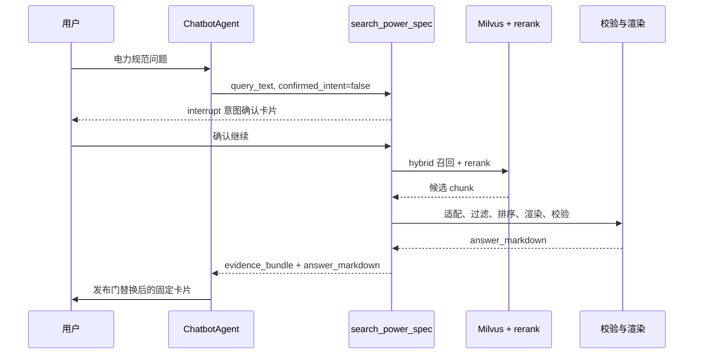

# 电力规范检索

本页解释电力规范条文怎样从上传的 PDF 变成可检索的条款证据，以及一次提问怎样变成规范卡片。它面向需要阅读、评审或修改该链路的开发者，重点是每层的 Owner、数据形态和可逐步执行的调试入口。配置项清单见[文档处理](../advanced/document-processing.md)，Agent 配置方法见[配置和开发智能体](../agents/agents-config.md)。

## 适用范围

电力规范检索由三条相互独立的链路组成，修改其中一条不会自动修复另外两条。

- **入库链路**：解析后的 Markdown 变成 PostgreSQL 元数据、PostgreSQL chunk 和 Milvus 向量。
- **检索链路**：用户提问变成条款证据，再变成固定格式卡片。
- **发布链路**：Agent 最终助手消息的来源被强制替换为工具产出的卡片。

只修检索链路无法让错误解析的文档变正确；只修入库链路无法修正已被模型改写的答案。判断故障属于哪条链路是本页最主要的用途。

## 组件与依赖



依赖方向只有一条：`tool` 只做权限与行为链编排，意图、入库、检索和答案组织各自拥有模块，跨模块流动的数据形状统一由 `contracts` 拥有。条款解析被入库链路的两个入口共享，因此修改解析规则会同时影响分块内容与元数据。

## 入库：从解析结果到可检索条款

### 页面触发

知识库的 `additional_params.chunk_preset_id` 取 `power_spec` 时，该知识库进入电力规范模式。解析任务在完成通用解析后追加条款提取，入库任务在通用分块时改走条款分块。两个任务各自读同一个预设值，因此预设值决定链路是否成立，而单独的 `power_spec_mode` 标志位只作为兼容开关保留。

### 条款提取与质量门

`parse_power_spec_text` 负责把解析后的 Markdown 转成 `PowerSpecDocument`。它按标准文档的写法提取三类信息：

- **条款**：优先按 Markdown 条款标题（`## 6.1 油浸式电力变压器和电抗器`）切分，正文到下一个标题为止；没有这种标题的旧式 PDF 文本回退到行首编号规则（`6.1 上层油温限值`）。只有标题、没有自身正文的分层章节不产出条款。`附录 X` 标题与附录子条款（`## A.3…`、`#### B.2.1…`）都是边界：附录正文不会并入上一条，附录子条款自身产出条款，附录块只在没有子条款时成条。
- **目录**：从 `## 目 次`／`## 目录` 这类标题到同级或更高级的 Markdown 标题之间整块跳过。人工整理的文档常把目录条目也写成标题，此时同级规则拦不住，改按条目自身内容识别：带引导点的标题，或页码与相邻目录条目共同表明是目录的标题（含页码落在下一行的跨行条目）不产出条款，但仍截断上一条正文，避免目录文字并进条款。仅凭结尾数字不判定目录，否则 `…见表 49` 这类正常条款标题会被丢弃。
- **标准编号与名称**：封面只写「代替 DL/T 393—2010」时，用发布日期年份推导本版编号（`DL/T 393-2021`），避免把卡片上的编号写成上一版；编号保留原文是否带 `/T`，统一编号前空格和年份前的 ASCII 连字符，并保留分部号（`GB/T 1094.2-2013`、`GB 50054-2011`），否则分部号会丢失并退化成正文引用的另一部标准。名称优先取「代替…《名称》」，其次文档一级标题，都不成立时退回编号原文。

条款页码取自标题之前最近的 `<!-- source_pdf_page: N -->` 标记，写入 `clause.source_page`，保留在证据对象中供回溯；最新卡片契约不再把页码作为展示字段。

质量门 `_quality_failure_reason`（写入）与 `is_power_spec_metadata_ready`（读取）共用 `_clause_quality_failure` 这一条规则，主要判据是过短正文占比（正文短于 20 字视为没拿到内容，占比超过 0.2 即拒绝）；标题只剩编号且正文也短时给出更具体的拒绝原因。未通过的文件不会写入元数据，检索时会把它们整体排除。

条款标题写成 `## 6.4.1.1` 这类纯编号时，标题取紧邻的下一级标题（如 `### 表17 …`），正文从该标题之后开始；确实没有标题的条款用编号作标题，只要正文充分就是可用证据。单级编号（`## 6`）仍按章节处理。

没有正文的分层标题与标题为「表N」的纯表格片段不产出条款；这类文件需要按 `general` 分块，否则 `index_file` 会因解析失败而把文件置为 `error_indexing`。
`PostgresPowerSpecExtractionStore` 把结果写入 `knowledge_files.processing_params["power_spec"]`，其中 `clauses` 是该文件全部条款的轻量投影。检索时的条款编号、标题、正文和适用范围都来自这里，而不是 chunk 内容；卡片只发布规范名称、标准编号、条款编号和条款正文这四个字段。

### 分块与索引

分块阶段复用同一个 `parse_power_spec_text`，把每个条款渲染成一个 chunk。因此元数据与 chunk 是同一份解析结果的两个投影：元数据提供展示字段，chunk 提供向量与稀疏索引。

`MilvusKB.index_file` 负责嵌入与双写。写入前按 UTF-8 字节切分超长 chunk，因为 Milvus 的 `content` 字段上限是 65535 字节而不是字符数，中文内容的字节数约为字符数的三倍。切分后的片段编号为 `原序号 * 1000 + 分片序号`，同一 SQL 双写到 Milvus 与 PostgreSQL，任一侧失败即整体回滚。

## 检索：从提问到规范卡片



### 意图确认

工具第一次调用时使用 `confirmed_intent=false`。此时它先调用模型识别意图，把用户问题重述为完整可检索的规范问题，并给出查询类型、设备、电压等级、问题维度和检索关键词，然后调用 LangGraph 的 `interrupt` 展示确认卡片。

用户在确认卡片上选择继续后，恢复的是同一次工具调用，因此业务提示词要求模型不要重新调用工具，也不要把确认结果当作新的查询参数。

用户选择不正确时，工具按两种情形处理：卡片中同时填写了修正说明时，直接带上一轮识别结果和该修正重新识别；只选择不正确而没有文本时，先追问需要修正的内容，再重新识别。重新识别会再次展示确认卡片，最多 3 轮，超过后终止并提示用户重新描述问题。

意图识别优先使用模型结果，模型不可用或返回非法 JSON 时回退到 `parse_power_spec_query` 的规则解析。模型识别使用 `temperature=0` 且关闭思考，因为 LangGraph 在每次 resume 时会重新执行整个节点，需要保证展示给用户的计划与确认后实际使用的计划一致。

关闭思考的参数是 `extra_body.chat_template_kwargs.enable_thinking`。该服务忽略请求体顶层的 `enable_thinking`，模型配置界面的 `request_body_overrides` 白名单也不包含 `chat_template_kwargs`，因此只能由调用点显式传入。`max_tokens` 受服务 `max_model_len` 限制，超过会被拒绝而不是截断。

### 召回与编排

`executor.aquery` 执行 Milvus hybrid 检索（稠密向量与 BM25 稀疏向量），再用知识库配置的 reranker 重排。送排前每条文档按 `RERANK_MAX_DOCUMENT_CHARS` 截断：超长条款全文送排会把单路召回拖到客户端超时，超时后整批按 0.5 兜底。知识库没有配置 `reranker_model` 时关闭重排，仍用问题路与关键词路的召回分数检索，并在工具结果 `warnings` 中记录降级。`PowerSpecSearchService` 在这之后按现行状态过滤、按问题维度匹配，再用 RRF 名次融合两路分数（关键词路独有条目的两路分数都不高于问题路最低分），最后按引用键去重并组装 `EvidenceBundle`。

排序对同时命中多个维度的条款加权，因此问题里包含的设备、电压等级和维度词会直接影响卡片顺序。

### 渲染与校验

`adapt_vector_results` 把召回 chunk 转成 `SpecClauseEvidence`，同时把原始正文字段和解析正文字段一起放进 `metadata`，供校验回溯。展示正文按行挑选：命中行所在的连续内容块整块保留（表格与普通段落同等对待，避免丢掉表头、分隔行与引出语引出的条目），短于 `MAX_UNFILTERED_BODY_CHARS` 的条款不裁剪；分块渲染拼在首行的「编号 标题」在展示前去掉，避免与卡片的条款编号字段重复。原文全文始终留在 `metadata`。

卡片载荷与 `answer_markdown` 只包含规范名称、标准编号、条款编号和条款正文。条款标题、适用范围、规范状态、替代关系与页码仍保留在证据对象中，供检索、校对和投影校验使用；相关度由 `rerank_score` 派生，引用键由 `document_id#clause_no` 生成，都不进入卡片。

`verify_evidence_projection` 要求条款编号、标题和正文都能回溯到原始证据；卡片只展示其中的编号和正文。正文的判定粒度是「逐段、按序可回溯」，因此允许挑选不连续命中的原文行，但禁止编造内容或改变顺序。

### 模型组织答案

证据通过投影校验后，工具按「整理 → 审查 → 合并」三步组织答案。每步只执行一次，任一步失败即回退固定卡片。

1. 整理子智能体 `power-spec-organizer` 接收用户问题、意图识别给出的关注维度与受限条款原文，逐条输出 JSON 中的 `body`。它可以改写、分条和重新组织语言，但必须列出与问题相关或最接近的原文内容，不得改变数值、单位、条件、期限和判据的含义，每条结论带 `[source:document_id#clause_no]` 引用。
2. 审查子智能体 `power-spec-reviewer` 同时接收原文与整理结果，核验编造、事实错误、遗漏、无关内容和引用有效性，只输出审查意见 `{"issues":[...]}`，不给出通过与否的判定。
3. 主智能体（父 Agent 的模型，非子智能体）以整理内容为基础结合审查意见产出最终 `body`，然后直接发布。提示词要求只修改「判断确实成立」的意见，审查意见与整理内容冲突时保留整理内容。

三个环节都从模型输出中**提取** JSON 对象（容忍前面的分析文字与代码块围栏），而不是要求整段就是 JSON。实测本地模型会先写一段分析再在末尾用代码块给出 JSON，若只解析整段文本，合法结论会被当成解析失败丢弃。

代码保留两道廉价检查，它们不再阻断流程，而是各转成一条审查意见交给第 3 步修正：整理结果中的每个数字必须能在原文或用户问题中找到（按完整数字词元比较，`12` 不会被 `2021` 当成有依据）；正文不得为空或只写「本条款未涉及该问题」这类占位说明。

### 降级与发布标记

流程不重试、也不询问用户，因此不存在「用户接受未核验结论」这条路径。以下情况直接输出程序生成的固定卡片：未提供工具调用标识、整理或审查子智能体不可用、整理或合并输出不可解析、合并后没有可用条款。

工具在返回结果中给出 `answer_source` 与 `answer_verified`。`answer_verified=false` 表示审查提出了意见，且意见已由主智能体合并进正文，不再是「未通过审查」的意思。发布门只发布工具给出的 `answer_markdown`，因此发布判断只存在于工具一处。

子智能体在工具内启动并同步等待，父运行在等待期间占用一个 worker 槽位。默认并发足够单个用户使用，高并发时需要按 `max_jobs` 评估容量。

### 发布门

`chat_service` 在保存助手消息前检查该轮上下文是否启用 `power-spec` 技能。命中时用工具返回的 `answer_markdown` 覆盖模型输出，模型自行改写的版本不会落库。这个问题在排查答案格式异常时很关键：如果卡片字段正确但文字被改写，说明覆盖未生效。

覆盖只认**本轮**产生的检索结果。checkpoint 的 `messages` 是线程完整历史，直接倒序取第一个带 `answer_markdown` 的工具消息会在本轮未调用检索工具时命中上一轮的卡片，把旧结果当成本轮答案。归属判定优先按当前运行的 `tool_call_id`，与工具消息对账使用同一标准；运行归属不可用时按最后一条用户消息划界。本轮没有检索结果时回退到模型自己的内容。

## 数据 Owner 与形态

| 数据 | Owner | 形态 |
| --- | --- | --- |
| 原始解析结果 | MinIO | `knowledgebases/<kb_id>/parsed/<file_id>.md` |
| 条款元数据 | PostgreSQL `knowledge_files.processing_params["power_spec"]` | 文档字段加 `clauses` 数组 |
| 待检索正文 | PostgreSQL `knowledge_chunks`、Milvus collection | 一行为一个条款或条款分片 |
| 检索证据 | `power_spec/contracts.py` 的 `SpecClauseEvidence` | 冻结模型，含 `citation_key` |
| 证据集合 | `EvidenceBundle` | 问题、场景、实体加证据列表 |

检索阶段不读 chunk 内容作为展示正文，展示正文字段来自条款元数据。这解释了为什么正文格式异常通常意味着元数据需要重建，而不是向量库需要重建。

## 权限与边界

- 工具先解析当前用户可见的知识库集合，未显式指定 `kb_id` 时只在恰好一个可见库时自动选择，否则返回未检索到资料。
- 元数据过滤保留就绪文件，未就绪文件被排除而不是让整次检索失败。
- 沙盒虚拟路径、对象 URL 与宿主机路径不混用，文件内容通过知识库管理器读取。

## 失败、恢复与观察边界

| 现象 | 含义 | 下一步 |
| --- | --- | --- |
| `未检索到资料` | 无可用证据，或证据未通过投影校验 | 分层确认召回数量与校验结论 |
| `电力规范知识库尚未完成条款级重建` | 有召回但全部被元数据过滤 | 检查 `processing_params.power_spec` |
| 入库失败 `length of varchar field content exceeds max length` | 字节上限 | 检查字节切分是否生效 |
| 卡片字段正确但文字被改写 | 发布门未生效 | 检查该轮上下文是否启用技能 |
| 卡片正文只剩「…如下：」这类引出语 | 行级挑选把它引出的条目当作无关内容裁掉了 | 短条款不裁剪、长条款按块保留；确认 `MAX_UNFILTERED_BODY_CHARS` 未被改动 |
| 第二轮重复出现上一轮的卡片 | 发布门跨轮取用了历史工具结果 | 检查该轮是否调用过检索工具；未调用时应当只输出模型自己的内容 |
| 条款缺失 | 重建窗口或解析规则截断 | 对比全文行数与条款数 |
| `answer_source=fixed_card` | 子智能体不可用，或整理/合并输出里找不到 JSON 对象 | 查看日志中的降级原因；对比子智能体线程里的原始输出 |
| `Rerank 降级：N/M 批失败` | 重排批次在客户端超时内没有返回，该批按 0.5 兜底 | 查看当批文档长度与重排服务负载；本次排序与相关度不可信 |
| `answer_verified=false` | 审查提出了意见，已合并进正文 | 查看日志中的审查意见条数 |
| 子 run 立即变为 `cancelled` | 父运行缺少运行态（lease/owner） | 用真实页面运行复现，不要注入运行记录 |

知识库没有配置 `reranker_model` 时，工具不返回配置错误，而是关闭重排继续检索，并在结果 `warnings` 中带上「未配置重排模型，已按召回分数排序」；日志同时记录一条 warning。此时排序只依赖问题路与关键词路的召回分数。

工具会把结果缓存在运行上下文里，同一轮对话不会重复检索。排查时使用新的会话线程，避免读到上一轮的缓存结果。

## 源码定位

- [电力规范路由接入](https://github.com/xerrors/Yuxi/blob/main/backend/server/routers/knowledge_router.py)：解析任务追加条款提取，分页读全 Markdown
- [条款解析与重建](https://github.com/xerrors/Yuxi/blob/main/backend/package/yuxi/knowledge/power_spec/ingestion.py)：标准信息、条款边界、范围识别、质量门与元数据重建
- [意图分析](https://github.com/xerrors/Yuxi/blob/main/backend/package/yuxi/knowledge/power_spec/intent.py)：模型意图识别、规则兜底与确认卡片
- [召回与校验](https://github.com/xerrors/Yuxi/blob/main/backend/package/yuxi/knowledge/power_spec/retrieval.py)：证据适配、现行过滤、维度匹配、投影校验与字段校对
- [答案组织与渲染](https://github.com/xerrors/Yuxi/blob/main/backend/package/yuxi/knowledge/power_spec/answer.py)：整理、审查与最终合并编排、四字段卡片渲染
- [检索工具](https://github.com/xerrors/Yuxi/blob/main/backend/package/yuxi/knowledge/power_spec/tool.py)：权限、意图确认、行为链编排与结果缓存
- [数据契约](https://github.com/xerrors/Yuxi/blob/main/backend/package/yuxi/knowledge/power_spec/contracts.py)：查询、证据与验证结果模型
- [Milvus executor](https://github.com/xerrors/Yuxi/blob/main/backend/package/yuxi/knowledge/implementations/milvus.py)：分块、字节切分、双写与召回
- [分块调度](https://github.com/xerrors/Yuxi/blob/main/backend/package/yuxi/knowledge/chunking/ragflow_like/dispatcher.py)：`power_spec` 分支与长度保护
- [业务提示词](https://github.com/xerrors/Yuxi/blob/main/backend/package/yuxi/repositories/agent_repository.py)：电力规范 Agent 的固定提示词
- [发布门](https://github.com/xerrors/Yuxi/blob/main/backend/package/yuxi/services/chat_service.py)：用工具卡片覆盖模型输出
- [技能定义](https://github.com/xerrors/Yuxi/blob/main/backend/package/yuxi/agents/skills/buildin/power-spec/SKILL.md)：模型可见的检索约束
- [单元测试](https://github.com/xerrors/Yuxi/tree/main/backend/test/unit/knowledge)：解析、适配、渲染与校验

## 分层调试

每一层都能独立调用，因此可以先用一次调用定位断点，再决定是否需要重建数据。以下命令都在仓库根目录执行，`api` 是后端容器。命令使用 Compose v2 的 `docker compose` 形式，只提供旧版入口的环境改用 `docker-compose`，参数不变。

### 环境自检

先确认服务与模型可用，避免把外部服务故障误判成代码缺陷。

```bash
docker compose ps
docker compose logs --tail=50 api worker
docker compose exec -T api python -m pytest test/unit/knowledge -q -p no:cacheprovider
```

容器内执行测试需要 `-p no:cacheprovider`，因为挂载目录不允许写入缓存。

### 解析层

这一层回答「解析器把文档看成了什么」。它不需要数据库，速度最快，适合修改解析规则后反复验证。

```bash
docker compose exec -T api python - <<'PY'
import asyncio
from sqlalchemy import select
from yuxi.knowledge.runtime import knowledge_base
from yuxi.knowledge.power_spec.ingestion import parse_power_spec_text
from yuxi.storage.postgres.manager import pg_manager
from yuxi.storage.postgres.models_knowledge import KnowledgeFile

KB, FID = "kb_xxx", "file_xxx"

async def main():
    async with pg_manager.get_async_session_context() as db:
        markdown_file = (
            await db.execute(select(KnowledgeFile.markdown_file).where(KnowledgeFile.file_id == FID))
        ).scalar_one()
    executor = await knowledge_base.get_kb_executor(KB)
    text = await executor._read_markdown_from_minio(markdown_file)
    document = parse_power_spec_text(text, document_id=FID)
    print("name=", repr(document.standard_name))
    print("no=", repr(document.standard_no))
    print("scope=", repr(document.scope))
    print("clauses=", len(document.clauses))
    for clause in document.clauses[:3]:
        print(clause.clause_no, repr(clause.clause_title), len(clause.clause_body))

asyncio.run(main())
PY
```

判据：条款数与文档规模是否相称；`standard_name` 是否是可读名称而不是页码或表格标记；正文行数是否大于 1。

### 元数据层

这一层回答「检索时的展示字段是否存在且就绪」。条款元数据缺失时，检索会返回知识库未就绪而不是空结果。

```bash
docker compose exec -T api python - <<'PY'
import asyncio
from sqlalchemy import select
from yuxi.knowledge.power_spec.ingestion import is_power_spec_metadata_ready
from yuxi.storage.postgres.manager import pg_manager
from yuxi.storage.postgres.models_knowledge import KnowledgeFile

KB = "kb_xxx"

async def main():
    async with pg_manager.get_async_session_context() as db:
        rows = (
            await db.execute(
                select(
                    KnowledgeFile.file_id,
                    KnowledgeFile.filename,
                    KnowledgeFile.status,
                    KnowledgeFile.chunk_count,
                    KnowledgeFile.processing_params,
                ).where(KnowledgeFile.kb_id == KB, KnowledgeFile.is_folder.is_(False))
            )
        ).all()
    for file_id, filename, status, chunk_count, params in rows:
        metadata = (params or {}).get("power_spec") if isinstance(params, dict) else None
        ready = is_power_spec_metadata_ready(metadata) if isinstance(metadata, dict) else False
        print(file_id, status, chunk_count, "preset=", (params or {}).get("chunk_preset_id"),
              "clauses=", len((metadata or {}).get("clauses") or []), "ready=", ready, filename)

asyncio.run(main())
PY
```

判据：`clauses` 非零且 `ready=True`。文件状态是 `indexed` 但 `clauses` 为零，说明只完成了入库而没完成条款提取。

### 召回层

这一层回答「向量库能召回多少、重排结果如何」。它是区分「检索为空」和「校验拒绝」的关键分界点。

```bash
docker compose exec -T api python - <<'PY'
import asyncio
from yuxi.knowledge.power_spec.intent import parse_power_spec_query
from yuxi.knowledge.runtime import knowledge_base

KB = "kb_xxx"
QUERY = "110kV变压器的温升限值是多少"

async def main():
    query = parse_power_spec_query(QUERY)
    config = await knowledge_base.get_kb_config(KB)
    reranker = config.query_options.get("reranker_model")
    rerank_kwargs = {"use_reranker": True, "reranker_model": reranker} if reranker else {"use_reranker": False}
    executor = await knowledge_base.get_kb_executor(KB)
    raw = await executor.aquery(
        query.query, KB, config=config, agent_call=True,
        use_graph_retrieval=False, **rerank_kwargs,
        recall_top_k=30, bm25_top_k=30, final_top_k=20,
    )
    print("intent=", query.intent, "device=", query.device_type, "voltage=", query.voltage_level)
    print("dimensions=", query.answer_dimensions)
    print("normalized_query=", repr(query.query))
    print("recalled=", len(raw))
    for item in raw[:5]:
        metadata = item.get("metadata") or {}
        print(round(item.get("rerank_score") or 0, 4), metadata.get("file_id"), str(item.get("content"))[:60])

asyncio.run(main())
PY
```

判据：`recalled` 大于零说明向量库有数据。`recalled` 为零时问题在入库或知识库配置，不在检索工具。`normalized_query` 会打印实际送去嵌入的文本，用于确认问题改写是否符合预期。

### 适配、编排与校验层

这一层回答「召回的候选为什么没有变成卡片」。它一次性复现工具内部除意图确认以外的全部逻辑，并打印每一步的数量变化。

```bash
docker compose exec -T api python - <<'PY'
import asyncio
from yuxi.knowledge.power_spec.retrieval import adapt_vector_results
from yuxi.knowledge.power_spec.answer import format_power_spec_results
from yuxi.knowledge.power_spec.intent import parse_power_spec_query
from yuxi.knowledge.power_spec.ingestion import is_power_spec_metadata_ready
from yuxi.knowledge.power_spec.retrieval import PowerSpecSearchService
from yuxi.knowledge.power_spec.retrieval import verify_evidence_projection
from yuxi.knowledge.runtime import knowledge_base
from yuxi.repositories.power_spec_repository import PowerSpecRepository
from yuxi.storage.postgres.manager import pg_manager

KB = "kb_xxx"
QUERY = "110kV变压器的温升限值是多少"

async def main():
    query = parse_power_spec_query(QUERY)
    config = await knowledge_base.get_kb_config(KB)
    reranker = config.query_options.get("reranker_model")
    rerank_kwargs = {"use_reranker": True, "reranker_model": reranker} if reranker else {"use_reranker": False}
    executor = await knowledge_base.get_kb_executor(KB)
    async with pg_manager.get_async_session_context() as db:
        metadata_by_file_id = await PowerSpecRepository().list_power_spec_extractions(db, kb_id=KB)

    raw = await executor.aquery(
        query.query, KB, config=config, agent_call=True,
        use_graph_retrieval=False, **rerank_kwargs,
        recall_top_k=30, bm25_top_k=30, final_top_k=20,
    )
    ready = {fid for fid, md in metadata_by_file_id.items() if is_power_spec_metadata_ready(md)}
    filtered = [
        item for item in raw
        if str((item.get("metadata") or {}).get("file_id") or "") in ready
    ]
    evidence = adapt_vector_results(filtered, metadata_by_file_id, query.query)
    print("raw=", len(raw), "ready_files=", ready, "filtered=", len(filtered), "evidence=", len(evidence))

    async def graph_search(_query):
        return [item for item in evidence if item.metadata.get("graph_score") is not None]

    async def vector_search(_text):
        return evidence

    result = await PowerSpecSearchService(graph_search, vector_search).search(query)
    print("no_result=", result.no_result, "selected=", len(result.evidence))
    if not result.evidence:
        return

    verification = verify_evidence_projection(result.evidence)
    print("verify=", verification.valid, [issue.code for issue in verification.issues])
    formatted = format_power_spec_results(query.query, result.evidence)
    for line in formatted["answer_markdown"].splitlines()[:24]:
        print(line[:100])

asyncio.run(main())
PY
```

判据：`filtered` 少于 `raw` 说明元数据过滤生效；`selected` 为零说明现行状态或维度匹配淘汰了全部候选；`verify=False` 说明展示内容无法回溯，此时打印的 `issues` 会给出具体失败码。

### 工具整体

这一层验证工具的真实返回，包括结果缓存和固定格式。它绕过意图确认，因此适合在确认流程之外的快速回归。

```bash
docker compose exec -T api python - <<'PY'
import asyncio
from yuxi.knowledge.power_spec.tool import search_power_spec

class Context:
    uid = "1"
    knowledges = ["kb_xxx"]

async def main():
    runtime = type("Runtime", (), {"context": Context()})()
    result = await search_power_spec.coroutine(
        query_text="110kV变压器的温升限值是多少",
        confirmed_intent=True,
        runtime=runtime,
    )
    if isinstance(result, str):
        print("plain=", result)
        return
    print("status=", result.get("status"), "found=", result.get("evidence_found"),
          "verified=", result.get("evidence_verified"), "mode=", result.get("retrieval_mode"))
    print(result.get("answer_markdown", "")[:1500])

asyncio.run(main())
```

判据：返回字典且 `evidence_verified=True` 表示工具会输出卡片；返回字符串表示工具判定无证据或知识库未就绪，字符串内容直接就是用户看到的文案。

### 日志与持久化核对

链路各层都有日志，用关键字过滤比通读日志更快。

```bash
docker compose logs --since=10m api worker | grep -E "Preparing chunk insert|Split oversized|Indexing failed|Reranking completed|Milvus hybrid query response"
```

| 关键字 | 含义 |
| --- | --- |
| `Milvus hybrid query response: N chunks found` | 召回数量 |
| `Reranking completed` | 重排完成与耗时 |
| `Split oversized chunks before embedding` | 有 chunk 被字节切分 |
| `Preparing chunk insert` | 写入前的实际最大字节数 |
| `Indexing failed` | 入库失败原因 |

条款正文与状态以数据库为准，不要以日志或模型输出为准：

```bash
docker compose exec -T api python - <<'PY'
import asyncio
from sqlalchemy import func, select
from yuxi.storage.postgres.manager import pg_manager
from yuxi.storage.postgres.models_knowledge import KnowledgeChunk, KnowledgeFile

FID = "file_xxx"

async def main():
    async with pg_manager.get_async_session_context() as db:
        file_row = (
            await db.execute(
                select(KnowledgeFile.status, KnowledgeFile.chunk_count, KnowledgeFile.error_message)
                .where(KnowledgeFile.file_id == FID)
            )
        ).one()
        chunk_count = (
            await db.execute(
                select(func.count()).select_from(KnowledgeChunk).where(KnowledgeChunk.file_id == FID)
            )
        ).scalar_one()
    print("status=", file_row[0], "declared=", file_row[1], "actual=", chunk_count, "error=", file_row[2])

asyncio.run(main())
PY
```

### 重建

修改解析规则、治理 OCR 输出或调整分块预设后，元数据与 chunk 都不会自动更新，必须重建。两者的触发方式不同：

- **chunk**：走入库任务（`knowledge_index`），它会重新读解析后的 Markdown 并按当前预设重新切分。`indexed` 状态允许重新入库。
- **条款元数据**：走重建服务。**`indexed` 状态的文件不允许再次解析**（`parse_file` 只接受 `error_parsing`／`uploaded`／`failed`），所以重建元数据不能靠「重新解析」按钮，要用下面的脚本或重新上传文件。

```bash
docker compose exec -T api python - <<'PY'
import asyncio
from yuxi.knowledge.power_spec import PowerSpecRebuildFile, PowerSpecRebuildService
from yuxi.knowledge.power_spec.ingestion import PostgresPowerSpecExtractionStore
from yuxi.knowledge.runtime import knowledge_base
from yuxi.repositories.power_spec_repository import PowerSpecRepository
from yuxi.services.knowledge_task_service import _read_power_spec_source
from yuxi.storage.postgres.manager import pg_manager

KB, FID = "kb_xxx", "file_xxx"

async def main():
    async with pg_manager.get_async_session_context() as db:
        name = await PowerSpecRepository().get_file_name(db, kb_id=KB, file_id=FID)
        rebuild_file = PowerSpecRebuildFile(kb_id=KB, file_id=FID, source_file=name)
        report = await PowerSpecRebuildService(PostgresPowerSpecExtractionStore(db)).rebuild(
            [rebuild_file], source=lambda _file: _read_power_spec_source(KB, FID), dry_run=False
        )
        print("rebuild=", report.items[0].model_dump(mode="json"))
        await db.commit()
    result = await knowledge_base.index_file(KB, FID, operator_id="1")
    print("index status=", result.get("status"), "chunks=", result.get("chunk_count"))

asyncio.run(main())
```

先把 `dry_run` 设为 `True` 可以只运行质量门而不写库，用于确认新规则是否会被拒绝。重建会覆盖该文件的条款元数据并重新生成 chunk，因此不要在共享知识库上批量试跑。

重建完成后按同一份 Markdown 核对两个投影是否一致：元数据 `clauses` 条数与文件 `chunk_count` 应当相等（条款与 chunk 一一对应）。

## 已清理的未接入能力

以下能力曾有实现与单元测试，但没有生产调用方，已于 2026-09-23 删除，避免评审时误以为它们是生效链路的一部分：

- `PowerSpecIngestionService` 与 `extract_from_source`：模型辅助的单文件提取入口。入库实际走 `PowerSpecRebuildService`，解析走 `parse_power_spec_text`。
- `adapt_graph_results` 与 `_is_clause_node`：图谱节点到条款证据的适配。召回当前只走向量与重排，`tool.graph_search` 只是从同一路结果里筛 `graph_score`。
- `build_clause_tags`、`PowerSpecExtractionStore`、`AsyncPowerSpecTextSource`：只服务于上面两个入口的辅助定义。

若将来要接入图谱召回或独立提取入口，按当时的真实需求重新实现，而不是恢复这批定义。

链路的生效路径是 `tool.py` 编排的意图确认与召回校验，以及 `answer.py` 的整理审查。

## 配置边界

| 配置 | 位置 | 作用 |
| --- | --- | --- |
| `chunk_preset_id = power_spec` | 知识库 `additional_params` | 启用条款分块与条款提取 |
| `reranker_model` | 知识库 `query_options` | 缺失时关闭重排继续检索，按召回分数排序并在 `warnings` 中说明降级 |
| `recall_top_k`、`bm25_top_k`、`final_top_k` | 工具内的检索选项 | 召回与候选宽度 |
| `max_execution_steps` | Agent `config_json.context` | 电力规范 Agent 期望值 300 |
| `POWER_SPEC_INTENT_ENABLED` | 环境变量 | 关闭后意图识别直接走规则解析 |
| `POWER_SPEC_INTENT_MAX_TOKENS` | 环境变量 | 意图识别、条款校对与最终整理共用的输出额度，受服务上下文上限约束 |
| `POWER_SPEC_ORGANIZE_ENABLED` | 环境变量 | 关闭后答案直接使用固定卡片 |
| `POWER_SPEC_CLAUSE_REVIEW_ENABLED` | 环境变量 | 关闭后跳过条款编号与标题的模型校对 |
| `POWER_SPEC_KEYWORD_QUERY_TERMS` | 环境变量 | 模型关键词召回使用的关键词数量上限（默认 8） |
| `EMBEDDING_RETRYABLE_STATUS_CODES` | `models/embed.py` | 可重试的嵌入状态码 |
| `RERANK_MAX_DOCUMENT_CHARS` | `models/rerank.py` | 送排单条文档的字符上限（默认 600），截断只影响排序 |
| `MAX_UNFILTERED_BODY_CHARS` | `power_spec/retrieval.py` | 短于此长度的条款正文不做行级裁剪（默认 1200 字符） |
| `MAX_MILVUS_CONTENT_CHARS` | `chunking/ragflow_like/dispatcher.py` | 分块阶段长度保护 |

修改检索选项或质量门阈值会改变卡片数量与顺序。修改解析规则会同时改变元数据与 chunk，必须重建后重新验证召回与校验两层。
